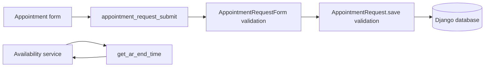

# COMP 441 Track C — Interim Report Draft

**Draft status:** engineering work and targeted evidence recorded; not a final submission. Replace all `TBD` items with group-verified evidence and review against the full assignment brief before submission.

## 1. Executive summary

The group selected `adamspd/django-appointment`, a Python/Django appointment scheduling application. This project focuses on temporal validation around appointment requests and duration conversion. Three test-driven fixes were implemented: reversed request intervals now raise a model validation error; negative `timedelta` durations are rejected; and fractional numeric durations preserve seconds. The focused regression run passed 66 tests, a separate run of three scenario tests and five selected integration tests passed 8 tests, and the CI-style suite passed 580 tests with 1 skip.

The candidate technical checks recorded here are an Apache-2.0 license, 5,961 Python source lines under the selected package directories (excluding tests/migrations), and 830 upstream commits at the import point (832 total commits including two course commits). Course coordinator approval remains pending. The candidate handles appointments and scheduling; it is not a patient-records or medication-validation system.

## 2. Project background and candidate qualification

### Candidate

- Name and source: [`django-appointment`](https://github.com/adamspd/django-appointment)
- Language/framework: Python and Django
- License: Apache License 2.0 (verify current license at final submission)
- Size/history snapshot: 5,961 non-test/non-migration Python lines in `appointment/` and `appointments/`; 830 commits at the local checkout
- Approval: **TBD — coordinator decision required**

### Problem statement

Incorrect appointment start/end ordering and duration handling can produce invalid or imprecise schedule data. The project improves the validation boundary and tests representative temporal cases. Scope is limited to appointment scheduling and related validation.

## 3. Requirements and design

The traceability matrix is in [`RTM.md`](RTM.md). Requirements include valid start/end ordering, accepted time/duration types, rejection of negative durations, preservation of fractional minutes, midnight wrapping, availability, authorization, and HTTP submission behavior.

The changes are intentionally narrow: validation stays in the appointment model; duration normalization and arithmetic stay in the existing date/time utility. No schema migration was required. Detailed design/architecture figure: **TBD — add a diagram based on verified source modules and data flow.**

Verified request path: a POST to `appointment_request_submit` is validated by `AppointmentRequestForm`; a valid form saves an `AppointmentRequest`, whose model save checks date/time ordering and duration before writing to the database. Separately, availability services call `get_ar_end_time` to calculate candidate end times.

## 4. Test-driven development and verification

See [`TDD_LOG.md`](TDD_LOG.md) for red/green evidence. The focused run on 14 October 2026 passed 66 tests in 33.234 seconds under coverage instrumentation. Three actual pytest-bdd Gherkin scenarios passed in 0.41 seconds. A separate run of three Django scenario counterparts and five integration tests passed 8 tests in 79.008 seconds. Python syntax compilation and `git diff --check` also completed without reported errors.

The upstream workflow runs a broader Python/Django matrix. The local full suite passed under the current Python/Django combination. Focused coverage and a scoped Pylint/Radon baseline are now recorded in [`METRICS.md`](METRICS.md) and [`STATIC_ANALYSIS.md`](STATIC_ANALYSIS.md). A seeded Mutatest sample on the date/time utility detected 19 of 23 mutants (82.6%) across eight of 46 candidate AST locations; four survivors are triaged in [`MUTATION_ANALYSIS.md`](MUTATION_ANALYSIS.md). This is not the required AI-only v1/hybrid v2 comparison, and it does not satisfy the eight v1 survivor case studies. Symbolic path reasoning is documented, but a tool execution is not claimed.

## 5. Behavior-driven and integration evidence

Three appointment-time Gherkin scenarios are in `BDD/appointment-time.feature`, with executable pytest-bdd steps in `appointment/tests/bdd/test_appointment_time.py`. CI runs these acceptance scenarios with pytest-bdd. Django test counterparts remain for the upstream test runner. Group/coordinator review should confirm scenario scope and acceptance-level classification.

Five selected integration cases and their descriptions are listed in [`INTEGRATION_TESTS.md`](INTEGRATION_TESTS.md). All five were included in the 8-test run and passed.

## 6. Defect prediction and analysis

The proposed model uses change churn features and human-reviewed historical defect labels, with chronological holdout and a majority baseline. The executable script is `scripts/defect_prediction.py`; no reviewed label file or model result exists yet. A documented risk-based test order is available as an interim prioritization method. Do not report classifier performance until label review, evaluation, and version capture are complete. Compare AI findings and static analysis only after recording the same code sample, independent ground truth, adjudication rules, and tool versions in [`AI_PROMPT_LOG.md`](AI_PROMPT_LOG.md).

## 7. Performance and usability

An in-process helper micro-load was completed with 20 worker threads over 120 seconds: 1,539,240 `get_ar_end_time` calls, 12,826.47 calls/second, 1.4764 ms median, 2.7411 ms p95, and zero exceptions. Runtime and limitations are in [`PERFORMANCE.md`](PERFORMANCE.md), with raw output in [`performance_run.json`](performance_run.json). This does not measure an HTTP endpoint or database. The group still needs a representative endpoint load test if required, and the Nielsen heuristic review remains pending. Record top usability issues and severity only after a real group review; follow course approval/consent requirements and use synthetic appointment data.

## 8. CI and quality gates

The GitHub Actions workflow installs supported Django/Python combinations and runs `appointment.tests`, then runs the pytest-bdd acceptance scenarios. The workflow is present in the public fork; a successful hosted run and an agreed coverage/mutation threshold gate still need verification. The assignment requires the hybrid suite in CI and a gate for both measures; do not claim that until configured and observed passing.

## 9. Team contributions and reflection

**TBD — group members must supply their names, assigned work, review contributions, and peer evaluation.** The AI assistance log records this assistant's role; generated content is not a substitute for human contribution records. Discuss limitations, coordination issues, lessons learned, and next steps using real group experience.

## 10. Conclusion

Three temporal-validation defects have reproducible regression tests and the focused verification runs passed. The project has a public repository, test plan, traceability draft, working Gherkin automation, and a measured but limited evidence set. It is not ready as a final submission until the group completes mutation v1/v2 and survivor analyses, classifier labels/results, exploratory/performance/usability sessions, CI quality gates, coordinator approval, authentic member/contribution records, AI declaration, and final report review.

## References

1. `adamspd/django-appointment`, GitHub repository and `LICENSE` (access date: TBD at final submission).
2. COMP 441 Group Project assignment brief, attached PDF (add required citation format/page numbers).
3. Framework/tool documentation used during evaluation (record URLs and access dates for every final claim).
